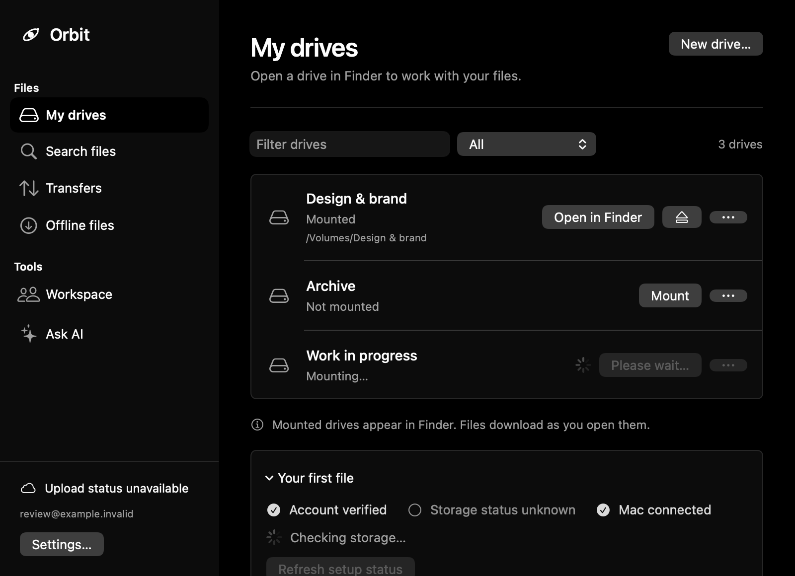
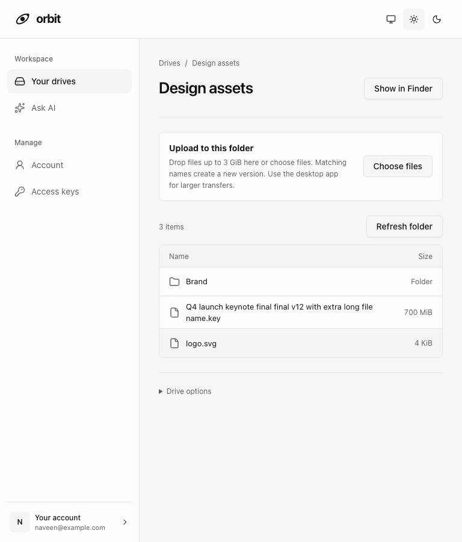

# Workspace layout · 2 November 2026

Orbit is a file workspace: navigation locates the task, the page heading names it, and the main list carries the content. This pass keeps the existing neutral identity and native controls.

## Layout plan

Use a shared list rather than separate tiles for each drive or search result. Each page is left aligned, with the same content edges. Actions belong beside the heading or beside the object they affect. Storage, setup and other supporting information follow the main content.

```
Navigation   Page title                         Primary action
             Description
             ------------------------------------------------
             Filter / scope                       List status
             Name + state                        Object actions
             Name + state                        Object actions
             ------------------------------------------------
             Storage / supporting information
```

Palette: canvas `#f6f6f6`, surface `#fdfdfd`, text `#111111`, secondary text `#606060`, border `#e4e4e4`; dark appearance retains the existing black, charcoal and white equivalents. System fonts match Finder and macOS controls. Titles are 26px/pt; section titles 16px on web and native headline on Mac; body 13–14px. Layout follows an 8px rhythm: 8 between controls, 16 inside rows, 24 between sections, 32 at the page edge.

Review against the request: no new visual identity, decorative cards or feature additions are needed. The distinctive element is the drive list itself, with quiet surfaces, visible group boundaries and consistent action placement. Existing dialogs, role checks, errors, upload wording and destructive confirmations stay connected to their current handlers.

## Scope

Web: application shell/navigation, shared CSS, drive workspace grouping and usage, file browser/upload controls, profile, access keys and team list presentation. Shared styles also reach billing and chat.

Mac: shared layout tokens, workspace heading/navigation/filter and drive rows, search results, offline controls, workspace account and transfer sections. Settings and onboarding retain their native form and staged layouts.

## Implemented

- The web shell uses fixed navigation and consistent page insets, with page content anchored at the top. Navigation separates workspace tasks from account management.
- Each workspace groups its header, drive rows, setup feedback and storage footer. Drive names and actions align; supporting storage information follows the list. Viewer empty states point to an owner or admin.
- File lists preserve room for filenames at tablet widths. Upload controls are grouped, and drive administration follows the folder contents.
- Profile, access keys and team forms have bounded field widths and consistent label spacing. Invitation metadata and actions use separate columns that wrap on smaller screens.
- Ask AI uses text-sized controls for the model selector and New conversation; both previously inherited icon-sized defaults.
- Mac page titles, filters, content lists and sidebar account status have consistent edges and section spacing. New drive belongs in the page heading, including when no drives exist.
- Mac Finder and eject actions stay in the drive row. Add a file is in Drive options with offline actions; the first-file guide now points there.
- Mac search and offline selections use shared lists. Workspace account controls and creation forms are grouped. Transfers has separate summary, storage, active and recent sections, and uses the page’s scroll view when embedded. Supporting text wraps without truncation.

## Verification

- Web: all 97 tests passed; the four Ask AI tests passed again after the final control-sizing change. Production TypeScript/Vite build passed. The existing large chat bundle warning remains.
- Mac: build and all 23 app tests passed, including light/dark render and AA contrast checks. Added 516-point search and transfer render fixtures; reviewed the 800 × 580 workspace and 520-point offline actions as well.
- Browser: 84 combinations of seven workspace screens, two appearances and six widths (320, 390, 601, 768, 1024 and 1440 pixels) had no horizontal page overflow or runtime errors. Filename columns retained usable width. Ten accessibility scans reported no serious or critical WCAG A/AA violations. [Browser check results](browser-checks.json).
- Additional browser review covered sign-in, file details/history, empty folders, viewer billing, invitation acceptance, missing pages, setup failures and dialogs in both appearances. Model and New conversation controls were separately checked with a fixture chat response at 320, 768 and 1440 pixels.
- All previews used local sample data. No live file operations, account changes, invitations or payments were performed. Full VoiceOver traversal and installed-app acceptance remain manual checks. No web deployment or Mac installation was performed.

## Review screenshots

[Web drive workspace](web-drives-light.png) · [Mobile drives](web-drives-mobile.png) · [Tablet file browser](web-files-tablet.png) · [Team](web-team-light.png) · [Ask AI](web-ai-dark.png)





[Mac transfers](mac-transfers-compact.png)
