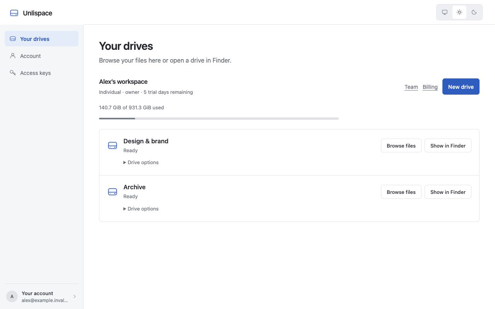
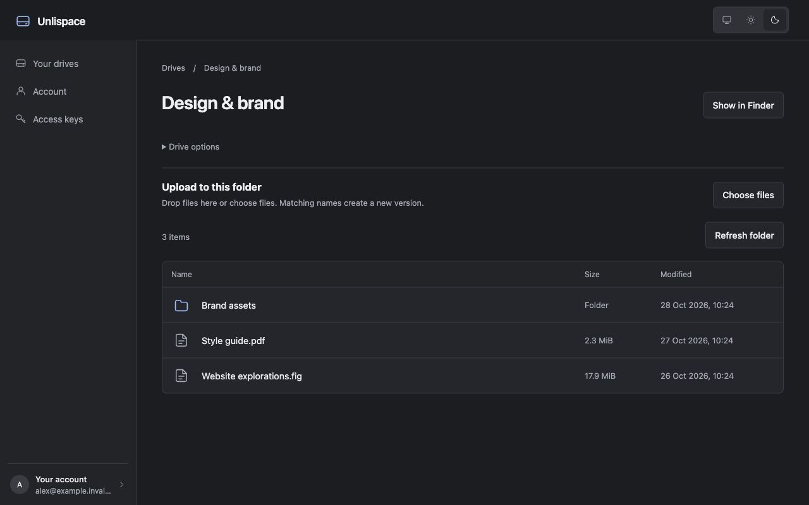
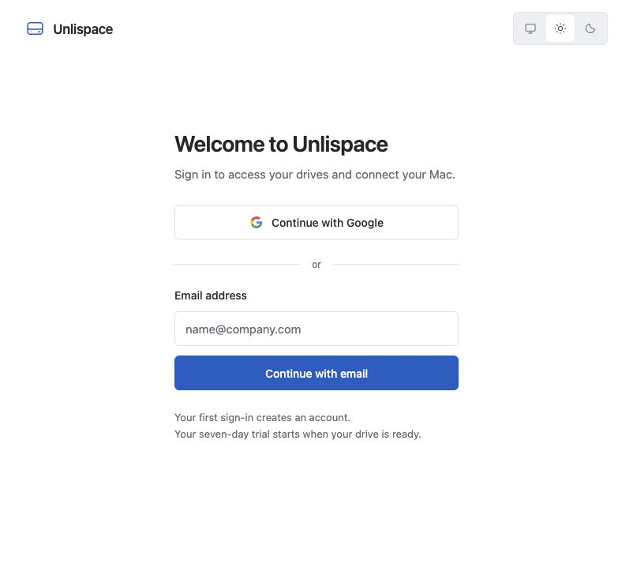
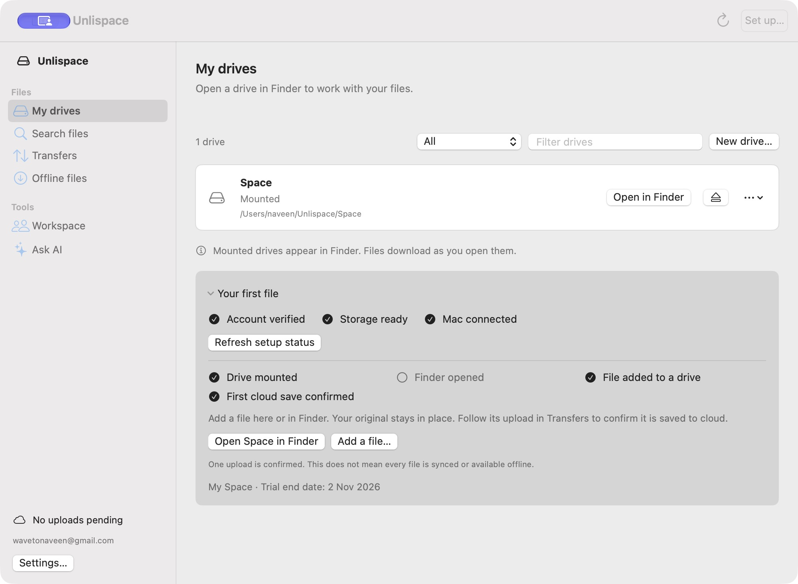

# Orbit interface refresh · 28 October 2026

Implemented in `/Users/naveen/.codex/worktrees/orbit-engine/orbit`, the existing product worktree. The main checkout still contains the subscription starter. Existing feature work in the product worktree was preserved.

## Design direction

Orbit is a file utility. The familiar object is a drive, and the first useful action is opening it. The interface now gives drive names, real status and file actions priority over introductory copy.

Two layouts were considered: independent drive cards and a shared drive list. The shared list fits this product better: people compare names and states, then browse or mount one. The Mac app uses native controls; the portal uses the same ordering and vocabulary.

```
Navigation       Page title
                 Workspace / trial / storage
                 Drive name + status       Browse / Finder
                 Drive name + status       Browse / Finder
                 Setup guide (Mac, collapsible)
```

The portal uses the platform system font so it matches the Mac rather than a marketing site. Headings are 24–29px, body text 15–16px and supporting text 13–14px. macOS retains the system's type sizes, controls and appearance preferences.

| Portal token | Light value | Role |
| --- | --- | --- |
| Background | `#ffffff` | Working canvas |
| Sidebar | `#f5f6f8` | Navigation |
| Text | `#24272e` | Main content |
| Muted | `#626873` | Supporting text |
| Border | `#dfe2e7` | Group boundaries |
| Accent | `#1b5dc6` | Primary action and selection |

Dark appearance has its own semantic values in `web/src/styles.css`. Corners follow the control: 6px for buttons and fields, 8px for related content. No new fonts, icon libraries or UI dependencies were added.

## Changes

- Removed slogans, the decorative wave, uppercase eyebrow labels, the rotated lettermark, hover shadows and page entrance animation.
- Replaced the portal's large drive tiles with compact rows and explicit Browse files / Show in Finder actions.
- Moved aliases, regions, lineage and administrative actions behind Drive options. Existing delete confirmations, role checks and version behavior remain in place.
- Kept Your drives visually selected while browsing its files.
- Restored visible sign-in labels, familiar field shapes and readable supporting text. Kept OTP recovery, Google sign-in and desktop return handling.
- Grouped native navigation into Files and Tools; reduced oversized titles and repeated card decoration.
- Placed the Mac first-file guide below the drives. It remains collapsible using its existing saved preference and retains readiness, trial and upload confirmation information.
- Clarified native setup, offline and transfer copy without changing permission or storage operations.

## Verification

Browser screenshots below use local sample data and a temporary mock API harness, removed after review. No real workspace changes or payments were performed.

- Web production build and all web tests passed; the test for file details also checks that drive navigation stays selected.
- Reviewed sign-in, drives, file browsing and billing in the browser. Light and dark appearances were inspected.
- Checked document width against viewport width at 320px, 375px and 1280px; no horizontal overflow in the inspected layouts.
- Native SwiftUI build, app behavior/permissions tests and the existing light/dark render test were run.
- Native NSView snapshots have limitations: without a window they omit some sidebar content; window-backed experiments produced vibrancy artifacts. Those experiments were removed and the existing renderer was preserved. Complete keyboard and VoiceOver traversal remain release checks. The subsequent deployment check below verifies the real installed workspace.

## Screenshots





[Phone drive list](web-mobile.png) · [Phone sign-in](web-login-mobile.png) · [Light file browser](web-files-light.png) · [Dark billing](web-billing-dark.png)

## Skill used

[Anthropic Frontend Design](https://github.com/anthropics/skills/tree/main/skills/frontend-design) was reviewed and installed at `/Users/naveen/.codex/skills/frontend-design`. Its guidance on purposeful layout, restrained decoration, clear copy and visual critique informed this pass. It is available for future turns. Ponytail guided reuse of the existing components and preservation of existing behavior.

## Deployment completed · 28 October 2026

- Portal: https://orbit-web.naveen-f3d.workers.dev
- Worker version: `de1376cf-a5a8-48f1-a7f6-068f2dbfac5d`.
- Previous Worker version retained for rollback: `98bb33eb-477b-4e86-a53e-32e40a0a4831`.
- Production API build target: `https://orbit-api.naveen-f3d.workers.dev`.
- Verified HTTP 200 and the exact built HTML on login, desktop handoff, auth callback, drive and billing SPA routes. The deployed JavaScript and CSS bytes match the local production build.
- Rebuilt and installed `/Users/naveen/Applications/Orbit.app`, version **0.2.1**, build **2**, and reopened it. The live UI shows the new navigation, drive rows and guide layout.
- The bundled engine is byte-for-byte identical to the previous installed engine. The existing daemon remained running. Account sign-in and the mounted drive were preserved; status reports zero pending operations and no pending uploads.
- Installer: `mac/build/Orbit-0.2.1.dmg`; its read-only mount, app signature and Applications link were verified, then the image was detached.
- Previous Mac bundle retained as `mac/build/Orbit-before-ui-2026-10-28.zip` for rollback.
- Deployment gates: 77 web tests; 74 Swift library tests, 17 app tests and the isolated daemon integration test passed. Keychain tests remained excluded and the separate browser/Worker integration test remained skipped.
- No backend Worker or database migration was deployed. No payment or workspace-file mutation was used for verification.

The Mac build is ad hoc signed for this machine. Developer ID/notarization and a public Sparkle release feed are not configured, so no public Mac update was published.

[Deployment metadata](deployment.json)




